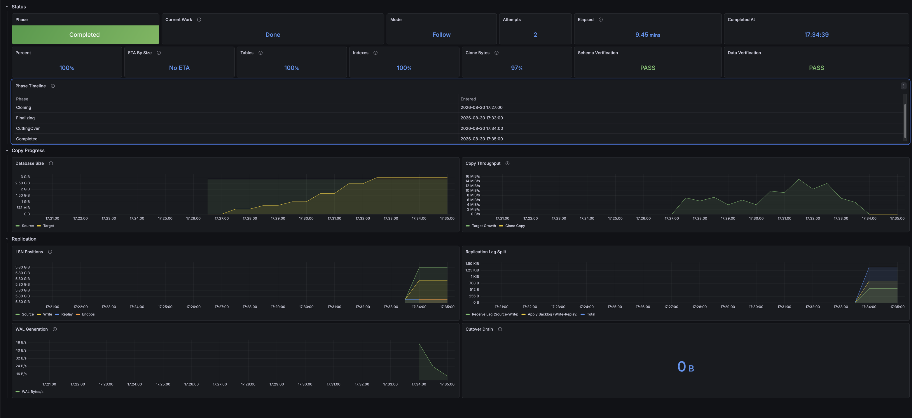

# Monitoring

The operator exports one set of Prometheus metrics for each Migration.
The Helm chart includes the parts that use these metrics: a ServiceMonitor for the scrape, alert rules as a PrometheusRule, and three Grafana dashboards.
Each of these parts is off until you enable it.
This page is the reference for the metrics.
It also tells you how to connect the chart to a kube-prometheus-stack setup.

## Scrape setup

The manager serves the metrics over HTTPS on :8443.
It authenticates every scrape.
`metrics.enabled` (default `true`) controls the endpoint and its Service.
With the Prometheus Operator, the scrape needs only `metrics.serviceMonitor.enabled=true`.
The ServiceMonitor sends the ServiceAccount token of Prometheus itself.
The ServiceAccount that scrapes also needs `get` on the `/metrics` nonResourceURL.
kube-prometheus-stack already gives this permission to its Prometheus.
The 401, 403, and 500 sections in [Troubleshooting](../troubleshooting.md) describe the failure modes.

The ServiceMonitor sets `honorLabels: true`, so the `namespace` and `name` labels on the migration metrics keep the values of the Migration.
The scrape does not rename them to `exported_namespace`.
The chart scrapes every 5 seconds.
This is the interval at which the operator samples the database sizes during a copy.
The gauges change when the operator samples the worker, so a slower scrape can miss samples between two changes.
If this is more traffic than you want, increase `metrics.serviceMonitor.interval`.
The dashboards then lag by the interval that you set.
`metrics.serviceMonitor.additionalLabels` adds labels to the monitor, for a Prometheus that selects monitors by label.
`scrapeTimeout`, `relabelings`, and `metricRelabelings` set the other scrape settings.

## Prometheus or OTLP?

The Prometheus scrape stays the default.
Use OTLP when your stack collects metrics through an OpenTelemetry Collector.
Use only one path for each Prometheus.
If the collector sends OTLP to a Prometheus that also scrapes the operator, each series arrives two times.
Then the rule of `PgcopydbMigrationCutoverStalled` fails to evaluate, and the other alerts fire two times.
The [OpenTelemetry guide](opentelemetry.md) tells you how to stop the scrape.

## Controller timing

A background sampler reads each running worker on its own timer, so a slow reconcile pass does not delay the size gauges.
The sampler takes its first sample as soon as a pass sees the worker Job.
Then it samples every 5 seconds until the data is across.
After that, it samples every 10 seconds, through the index and vacuum tail, streaming, and cutover.
Only the elected leader samples.
The sampler of a worker stops when the worker ends, and at a suspend or a deletion.
Each sample runs four psql statements from the worker pod.
They are the clone stage probe, a count of the target sessions that wait for synchronous replication, then the target size and the source size.
The count has a 3-second limit, and each of the other statements has a 6-second limit.
As a result, the four statements together stay inside the 30-second limit on the full exec.

A reconcile pass for an active worker still requests the next pass 10 seconds after the pass started.
The pass copies the relation counts and the clone stage of the latest sample into status.
It is the only writer of status.
During a copy, the size gauges therefore move every 5 seconds.
The relation counters, `status.progress`, and the phase move every 10 seconds.
Controller queue delays and other phase or retry paths can delay a pass, but they do not delay the sampler.

A pass that takes longer than 10 seconds logs `active worker observation` at the info level, with the time that each step took.
A sample that takes longer than its own interval logs `progress sample took longer than its interval`.

## Metric reference

Every `pgcopydb_migration_*` metric is a gauge.
Its `namespace` and `name` labels identify the Migration that it describes.
When the operator does not know a value, the series is absent, never zero.
Dashboards and alerts MUST treat a missing series as "no data", not as 0.

| Metric | Extra labels | Meaning | Exists |
|---|---|---|---|
| `pgcopydb_migration_phase` | `phase` | 1 for the current phase | always |
| `pgcopydb_migration_attempts` | | Worker Jobs created so far | always |
| `pgcopydb_migration_info` | `mode` | Always 1. The mode is `clone` or `follow` | always |
| `pgcopydb_migration_start_time_seconds` | | Unix time the first attempt started | once started |
| `pgcopydb_migration_completion_time_seconds` | | Unix time the migration completed | once completed |
| `pgcopydb_migration_condition_transition_timestamp_seconds` | `type`, `status` | Unix time of that condition's `lastTransitionTime` | per condition |
| `pgcopydb_migration_verified` | | 1 when every requested compare check passed, 0 if any mismatched | after a verification result |
| `pgcopydb_migration_verification_check` | `check`: `schema` or `data` | 1 when that check passed, 0 on mismatch, -1 when `spec.verification` does not request it | once the operator reads the spec, except a requested check with no result yet |
| `pgcopydb_migration_verification_planned_tables` / `_compared_tables` | `kind` | Tables a compare data run plans, and those it finished | per progress item |
| `pgcopydb_migration_verification_planned_bytes` / `_compared_bytes` | `kind` | Source size of those tables | per progress item |
| `pgcopydb_migration_verification_compared_rows` | `kind` | Source rows of the finished tables that match or differ | per progress item |
| `pgcopydb_migration_verification_differing_tables` / `_failed_tables` | `kind` | Finished tables that differ, and tables whose checksum query failed | per progress item |
| `pgcopydb_migration_verification_duration_seconds` | `kind` | Time from the start of compare data to its latest sample | per progress item |
| `pgcopydb_migration_verification_table_elapsed_seconds` | `kind`, `table` (`schema.name`) | Time spent on a table the run is still comparing | while in flight |
| `pgcopydb_migration_source_database_size_bytes` | | Source database size, summed over the instance with `allDatabases` | once sampled |
| `pgcopydb_migration_target_database_size_bytes` | | Target database size, summed over the instance with `allDatabases` | once sampled |
| `pgcopydb_migration_tables_done` / `_tables_total` | | Tables copied and tables planned | once sampled |
| `pgcopydb_migration_indexes_done` / `_indexes_total` | | Indexes built and indexes planned | once sampled |
| `pgcopydb_migration_clone_copied_bytes` / `_clone_planned_bytes` | | Table data on the target and on the source, then pgcopydb's counts after the copy (see [below](#why-does-the-target-show-fewer-bytes-than-the-source)) | once sampled |
| `pgcopydb_migration_target_sync_rep_waiting_sessions` | | Target sessions of the migration role that wait for a synchronous standby to acknowledge a commit | while sampled |
| `pgcopydb_migration_target_sync_rep_oldest_wait_seconds` | | Seconds since the oldest waiting statement started, 0 with no waiter | while sampled |
| `pgcopydb_migration_replication_lag_bytes` | | Total replication lag | follow, streaming |
| `pgcopydb_migration_source_lsn_bytes` | | Source write-ahead log (WAL) head as an absolute byte position | follow, streaming |
| `pgcopydb_migration_write_lsn_bytes` | | The walsender's `write_lsn` on the source, or the slot's `confirmed_flush_lsn` where the stat columns are masked | follow, streaming |
| `pgcopydb_migration_replay_lsn_bytes` | | Source-visible replay feedback, including certified idle progress, as an absolute WAL byte position | follow, streaming |
| `pgcopydb_migration_endpos_lsn_bytes` | | Cutover endpos as an absolute byte position | after cutover set it |
| `pgcopydb_operator_build_info` | `version` | Always 1. Operator-wide, with no migration labels | always |

The "Exists" column is the contract for when a series is present:

- **always**: from the first reconcile of the Migration until its deletion, which deletes every series.
- **once sampled**: the sizes are live samples from the worker pod, so they appear during an attempt.
  They keep their last value after the pod ends.
  The target size starts once a sample sees the copy, index, or vacuum workers of this attempt.
  This is because pgcopydb starts these workers only after it cleans the target.
  Before that, the target still holds the data that was there before the copy.
  A retry resumes into the same target.
  Its target size therefore keeps the last value of the previous attempt until a sample sees the workers of the retry.
- **once sampled** also applies to the single-database counters.
  These counters have two sources, and the second source is more exact.
  While the copy runs, the psql sample that reads the sizes also counts relations on both databases.
  It counts the tables that hold rows on the target, and their table bytes.
  It compares them with the tables that the target was given, and with the size of those tables on the source.
  It compares the indexes that the target built with the indexes that the source has.
  A table with no rows on the source has nothing to copy and counts as done.
  A table with rows on the source and no rows on the target does not count as done, whatever storage its restored schema holds.
  A table also does not count as done when one of pgcopydb's copy workers holds it under an exclusive lock.
  On a PostgreSQL 14 or later target, a table that the worker still copies into also does not count as done.
  The sample never reads such a table, because its rows stay invisible until that copy commits.
  An index worker takes a lock to attach a constraint `USING INDEX` to a copied table.
  This lock is short, and the sample waits for it.
  The sample needs psql and GNU `timeout` in the runner.
  Where the operator can read pgcopydb's own accounting, that accounting then replaces the sample.
  For a plain clone, this occurs at clone completion.
  For a follow migration, the operator reads the accounting from the log of the drain verification Job after cutover.
  Both need an allowlisted runner version (see [Troubleshooting](../troubleshooting.md)).
- **while sampled**: the two synchronous replication gauges follow every sample that reads them, zeros included.
  A sample that cannot read them deletes both, so a missing series means unknown, never "nothing waits".
  Unlike the sizes, these gauges also disappear when the sampler stops.
  As a result, an old count of waiting sessions never reads as current.
  The count includes every session of the migration role on the target, not only the sessions of pgcopydb.
  This is because any narrower filter can miss a waiter behind a proxy or a pinned `application_name`.
  PostgreSQL records no start time for the wait itself.
  The age therefore counts from the start of the waiting statement, and it is an upper bound.
- **follow, streaming**: a plain clone never produces these lag and log sequence number (LSN) gauges.
  In follow mode, they appear as soon as the replication slot answers.
  This occurs during the base copy, before the `Streaming` phase.
  The worker samples them from `Cloning` through `CuttingOver`.
  In every other phase, the operator deletes them, including the endpos gauge.
  It deletes them because the last sample is old and does not show the final drain.
  Prometheus keeps their history, so the graphs still show the run.
- **per progress item**: one series for each item of `status.verificationProgress`, labeled with its `kind`: `rehearsal`, `drain`, or `data` (see [Progress](verification.md#progress)).
  It appears with the first progress sample of that kind of run.
  It stays after the run ends, so it describes the Job that the `jobName` of the item names.
  When the operator creates the next Job of that kind, it deletes the item and its series.
  The first sample of that Job adds them again.
  `compare schema`, the exact-LSN drain path, and a runner that logs no compare progress leave no item, and thus no series.
- **while in flight**: one series for each table in the `inFlight` list of the item.
  A sample stops listing a table when the run finishes that table.
  A run can end without its last progress line, because it was canceled or its pod died.
  Such a run keeps the list of its last sample, and the series with it, until the next run of that kind starts.
- **per condition**: one series for each condition in `status.conditions`, labeled with the status that the condition changed into.
  A flip retires the old `{type,status}` pair and stamps a new pair.
  Thus the endpoint never carries more than one series for each condition type.
  The retired pair keeps its samples in Prometheus, so query the timeline as `last_over_time(...[$__range])`, not at the range end.
  This query puts both sides of a flip on the panel.
  It is also the only way to read a deleted Migration.

Read the timeline from the condition transitions, not from the phase.
Read completion from the table and index counters, not from the bytes.
After a complete copy, the two byte figures can end with different values (see [Why does the target show fewer bytes than the source?](#why-does-the-target-show-fewer-bytes-than-the-source)).

With `spec.clone.allDatabases: true`, each size gauge sums `pg_database_size(oid)` over the databases of its endpoint, and skips only `template0` and `template1`.
The target sum includes databases that already existed, not only the ones this Migration created.
Table, index, and clone-byte counters are absent in this mode.
The operator reads neither per-database relation counts nor the instance catalog's empty counters.

> [!note]
> Size gauges measure physical storage, not the bytes that this Migration transfers.
> The all-databases target gauge includes growth on unrelated target databases.
> Maintenance or recovery can make either gauge smaller.
> A slope estimates storage growth, not isolated copy throughput.
> Do not use `rate()` for these gauges, because it assumes a monotonic counter.

Each progress query runs under a timeout that connection-string options cannot disable.
A sample therefore leaves no session timeout that a later COPY or index build can inherit.
When one side fails, its gauges keep their last value while the other side updates.
When a side stops answering, the operator logs `progress sample lost a side` with the reason.
It logs again when that side answers.
The synchronous replication count has its own line, because its gauges disappear instead of keeping their last value: `progress sample lost the SyncRep count; until it answers again, CommitsBlocked stays True or turns Unknown`.
When the count answers again, the operator logs the same `progress sample side answers again` line, with side `syncrep`.
The reason is the error of the server, or the host and port of the failed connection.
The operator withholds any other psql message, because libpq echoes a connection URI that it cannot parse, and the password with it.
A failed sample never completes or fails a migration.

`status.progress.observedAt` is the time when the sampler took the sample that the relation counts in status come from.
A sample that loses either side writes nothing.
The timestamp therefore stops with the counts, and its age is how long the counts have not changed.
Read it together with the log.
An `observedAt` that is minutes old after a `progress sample lost a side` line, with no `progress sample side answers again` line since, means that status shows old figures.
The worker log tells you if the copy itself still moves.
`observedAt` is absent before the first counted sample and in all-databases mode.
pgcopydb's own count deletes it when that count replaces the estimate.

`pgcopydb_migration_phase` is an instantaneous gauge.
After the first `Pending` bootstrap, the phase summarizes the conditions.
The scrape never samples a phase that is shorter than the scrape interval.
A transition timestamp does not have this problem, because its value stays for as long as the condition holds.
A condition that changes two times inside one scrape interval publishes only the later transition, because the Migration keeps one `lastTransitionTime` for each condition.

Five quantities stay in PromQL and have no metric of their own:

- Receive lag is `source - write`.
- Apply backlog is `write - replay`.
- WAL generation is `rate(source_lsn_bytes)`.
- Percent done divides the target size by the source size.
- Compare throughput divides `verification_compared_bytes` or `verification_compared_rows` by `verification_duration_seconds`.
  The result is an average since the run started.

Receive lag reads high by one confirmation wherever `write` used the slot's `confirmed_flush_lsn` instead.
A pass whose source row carried no `confirmed_flush_lsn` keeps the earlier replay and lag values.
Both values are then stale for one pass, but not wrong.
Apply backlog reads both operands from the same walsender row, so the order that is true in that row is also true here.
Without `pg_read_all_stats`, both operands use the slot's `confirmed_flush_lsn` instead, and the difference reads zero.
This zero means unknown, not caught up.

The bundled runner, pgcopydb `0.18.144.g86bf908`, runs its target commits with `synchronous_commit=on` before it reports their replay progress.
On a target with synchronous standbys, each of those commits waits for a standby, whatever [`spec.target.synchronousCommit`](../configuration.md#synchronous-commit-on-the-target) says.
The `CommitsBlocked` condition reports a wait that lasts.
The runner writes that progress at most one time each second.
As a result, the replay gauge can be behind the target replication origin by about one second.
The runner can also [certify genuine primary keepalive positions](https://github.com/ydixken/pgcopydb/blob/86bf908adca02d87063849dae775a02c1659c829/src/bin/pgcopydb/ld_stream.c#L1628-L1653) from the current connection.
This moves the network feedback forward across filtered WAL.
That feedback does not move the target replication origin or the data replay cursor of the sentinel.
For the conditions, see [Follow diagnostics](../design/follow-diagnostics.md).
A replay gauge that increases on an idle publication therefore does not mean that the target has new rows.
It also does not measure applied-data throughput.
Other supported runner versions are different.
See [client tool versions](../reference/prerequisites.md#client-tool-versions).
Receive batching does not make these LSN slopes into end-to-end throughput measurements.
It also does not make the [drain-verification gate](live-migration.md#manual-cutover-runbook) unnecessary.

## Dashboards

The chart includes three dashboards.
Their shared `pgcopydb` tag links them to each other:

- **Migration Detail** (uid `pgcopydb-migration`): one migration end to end.
  Two rows of stat tiles come first: state and timing, then progress and the compare check results.
  Below them, two timeline tables are side by side: the phases as sampled, and the condition transitions as stamped.
  The other panels chart database sizes and copy throughput, synchronous replication waits, LSN positions with the lag split, WAL generation, and the cutover drain.
  A Verification row at the bottom charts the progress of each compare data run.
- **Fleet Overview** (uid `pgcopydb-fleet`): counts by phase, and an all-migrations table.
  The name column of that table links to the detail dashboard.
  The dashboard also shows lag, throughput, and attempt churn for each migration.
- **Operator Health** (uid `pgcopydb-operator`): build and leader status, reconcile rate and duration percentiles, and workqueue depth and latencies.
  The dashboard also shows the CPU, memory, goroutines, and file descriptors of the process.

All three dashboards refresh every 10 seconds, the same interval as the reconcile poll.
The Database Size panel and the two Copy Throughput panels step at 5 seconds, which is the scrape interval of the chart.
Each refresh therefore draws two new size points.
Their slopes use `deriv` over `$__rate_interval`, which Grafana sizes from that step: 20 seconds on a short range, or four samples.
The Clone Copy series and WAL Generation read gauges that the reconcile pass moves.
They therefore step at 10 seconds and average over 40 seconds.
A queued reconcile or a late scrape can still delay what reaches the screen.
The refresh picker of Grafana overrides the saved value for your session.



### Wiring the chart into Grafana

Two things must exist first, and the chart supplies neither of them.
You need a Prometheus that scrapes the operator ([Scrape setup](#scrape-setup) above), and a Grafana with that Prometheus as a data source.
When both exist, set two values:

```yaml
metrics:
  serviceMonitor:
    enabled: true
grafana:
  dashboards:
    enabled: true
    # The namespace Grafana runs in, not the one the operator runs in.
    namespace: monitoring
    folder: pgcopydb
```

`grafana.dashboards.enabled=true` renders each dashboard as its own ConfigMap, labeled `grafana_dashboard: "1"`.
The dashboard sidecar of Grafana watches that label.
It writes the data key of each ConfigMap as a file, and Grafana loads the file.
kube-prometheus-stack runs such a sidecar by default.
Check that the ConfigMaps are in the namespace that the sidecar watches:

```sh
kubectl get configmap -n monitoring -l grafana_dashboard=1
```

Two sidecar settings then decide if the dashboards appear, and where:

- **Namespace:** the sidecar watches only its own namespace, unless `sidecar.dashboards.searchNamespace` makes the scope wider.
  Thus `grafana.dashboards.namespace` must name the namespace that Grafana runs in.
  The release namespace of the chart is the default, and it is rarely correct.
- **Folder:** `grafana.dashboards.folder` writes a `grafana_folder` annotation.
  The sidecar acts on it only when its own `folderAnnotation` setting names that annotation, and `foldersFromFilesStructure` is on in its dashboard provider.
  If not, all three dashboards land in General, which is only cosmetic.

> [!warning]
> For the name of the file that it writes, the sidecar uses the **data key** of the ConfigMap, not the name of the ConfigMap.
> A second ConfigMap in that namespace with a `migration-detail.json` key therefore overwrites this one.
> The last writer wins, and nothing logs an error.
> The usual source of the second ConfigMap is a hand-imported copy that was kept for editing.
> These dashboards come from provisioned files, and they are not Grafana's own dashboards.
> Thus Grafana also refuses UI edits to them, unless the provider sets `allowUiUpdates: true`.
> The next provisioning pass overwrites each edit that Grafana accepted.
> Keep your changes in the JSON, or use "Save as" to make a copy with its own uid.

### Importing without the sidecar

Import the JSON by hand in Grafana (Dashboards, New, Import).
Render the copies that match the chart that you deployed, not the copies on `main`:

```sh
helm template pgcopydb-operator oci://ghcr.io/ydixken/pgcopydb-operator/charts/pgcopydb-operator \
  --set grafana.dashboards.enabled=true \
  --show-only templates/grafana-dashboards.yaml
```

Each ConfigMap in that output holds one dashboard under a `<name>.json` data key.
No panel hardcodes a data source.
After the import, select your Prometheus in the `datasource` variable of the dashboard.

### Reading Migration Detail

Two variables at the top select the migration: namespace, then name.
Both variables get their values from `pgcopydb_migration_info`.
Thus the list shows a Migration from its first reconcile until its deletion.

The tiles read as follows:

- **Phase** is the state that the operator is in.
  **Current Work** is the activity inside that state: `Validating` reads as Preflight Checks, `Finalizing` as Vacuum And Index Builds, and `Streaming` as Following WAL.
  Vacuum And Index Builds appears only after a sample saw the copy, index, or vacuum workers of this attempt.
  It also appears only when no copy worker remains.
- **Elapsed** is the time since the run started, and it stops when the run completes.
  **Completed At** reads Still Running until the run ends.
- **Percent** is the target size divided by the source size, with a maximum of 100.
  It is the coarsest progress reading, because it covers whole databases with their indexes and catalogs.
  The counters next to it count only the tables in scope.
  **ETA By Size** divides the bytes left by the current growth rate of the target.
  It reads No ETA outside `Cloning`, because index builds, the cutover drain, and verification do not move bytes at a steady rate.
  With `clone.deferIndexes`, the indexes arrive only in `Finalizing`.
  Percent therefore enters that phase near the share of the source size that is not indexes, not near 100.
  In that mode, ETA By Size overstates the time that the copy has left, because the bytes left include indexes that the copy never writes.
- **Tables**, **Indexes**, and **Bytes** are six tiles, one for each side.
  Each `(Source)` total is next to the `(Target)` figure measured against it.
  They read N/A before the target has a schema to count, and for a migration whose worker never ran.
  **Bytes** compares table data on both sides (see [Why does the target show fewer bytes than the source?](#why-does-the-target-show-fewer-bytes-than-the-source)).
  While the copy runs, one exception applies.
  It is a table that a copy worker holds under an exclusive lock, such as a table that pgcopydb copies whole.
  Until that copy commits, the target counts the bytes that the copy streamed into that table.
  A target before PostgreSQL 14 cannot report these bytes, and counts them as zero.
- **Schema Verification** and **Data Verification** are one tile for each compare check.
  Each tile reads Pending until its Job produces a result, then PASS or FAIL.
  A check that `spec.verification` does not request reads Deactivated.
  This is the default for both checks.
  A result has priority over the spec.
  Thus a check that you disable after it reported a mismatch still reads FAIL.
- **Cutover Drain** is the bytes still to replay before replay reaches the endpos.
  It reads No Endpos for a clone, and for a follow migration before a cutover sets an endpos.
  It reads 0 B once source-visible replay feedback reaches the endpos, which is what the screenshot shows.
  Only `CutoverCompleted`, after target-origin or content verification, proves the drain.
  After `CuttingOver`, the LSN series are gone, so the tile reads their last values in the time range.
  These values come from the last worker sample, which can be before the end of the drain.
  If the time range starts after that sample, the tile reads N/A.
  A follow migration that is `Failed` or `Suspended` also reads N/A when the time range has no endpos sample.
  The tile cannot tell if a cutover set an endpos for that migration.

Each tile applies to one Migration, so an empty result reads N/A.
Some tiles report a fact about the run, not its current state.
These tiles are Attempts, Elapsed, Completed At, the two verification tiles, and Cutover Drain.
They read over the whole range, so a deleted Migration keeps what it last reported instead of N/A.
They read the range end first, so a live Migration wins: a wide range can also hold an earlier run that reused the name.

The **Synchronous Replication Waits** panel, below the copy charts, plots the two synchronous replication gauges as **Waiting Sessions** and **Oldest Wait**.
**Oldest Wait** counts from the start of the waiting statement, so it is an upper bound on the wait itself.
A gap means that a sample could not read the count.
Both lines end when the worker pod ends.
Two samples in a row with a wait of 30 seconds or more set `CommitsBlocked`.
See [Commits blocked on synchronous replication](../troubleshooting.md#commits-blocked-on-synchronous-replication).
Healthy standbys can also cause this while they catch up on the WAL of a bulk load ([measured](https://github.com/ydixken/pgcopydb-operator/blob/main/docs/research/measurements.md#catch-up-waits-followed-a-bulk-load-with-both-standbys-attached)).

The **Verification** row charts `status.verificationProgress` with one line for each kind of compare data run: `rehearsal`, `drain`, and `data` (see [Progress](verification.md#progress)).

- **Compare Progress** is the share of the planned tables, and of their source size, that the run finished.
- **Compare Throughput** and **Compare Rows Per Second** divide the finished bytes and rows by the time since the run started, so they are averages.
  A table counts only after the run finishes it.
  Both values therefore fall while a large table runs, and they jump when that table ends.
- **Compare Duration** stops rising when the run ends, and its last value in the legend is how long the run took.
- **Differing And Failed Tables** counts both for each kind.
  For `rehearsal`, tables there are expected, because the source takes writes while the rehearsal compares.
  The legend marks the two `rehearsal` lines "expected while streaming".
  For `drain` and `data`, any table there fails that check.
- **Tables In Flight** lists the tables of each run's latest sample, with the time spent on each.
  A run that ended without its last progress line keeps its last list there.

### Why does the target show fewer bytes than the source?

**Bytes (Source)** is the size of the table data on the source: the tables in scope with their TOAST, without indexes.
While the worker runs, **Bytes (Target)** measures the target in the same way.
With the default runner and settings, pgcopydb's own count replaces both figures after the copy (see [Metric reference](#metric-reference)).
**Bytes (Source)** then shows the source table size from pgcopydb's catalog, and **Bytes (Target)** shows the bytes that the copy sent.

The bytes that the copy sent are not a size on disk, so they can be lower or higher than **Bytes (Source)**:

- They do not include dead rows.
- They do not include page headers, row headers, or free space.
- They carry TOAST values without compression.

In one of our test runs, they were 1.19 times **Bytes (Source)**.

While the worker runs, both figures are sizes on disk.
The exception is a table under the exclusive lock of a copy worker (see the tile notes above).
The copy writes every row again into new pages, so the target is often a little smaller than the source.
Updates and deletes leave dead rows and free space in the source tables, and the copy does not carry that space.
In our test, a plain `VACUUM` did not make the source table smaller.
Two settings can also change the size of the target on disk:

- A column without its own compression method takes the `default_toast_compression` of the target.
  In our tests, a change between `pglz` and `lz4` made a table of documents 25% smaller or 33% larger.
- A `fillfactor` that you set after you loaded the source table applies to every copied row.
  It does not apply to the rows that the source table already has.
  In our test, a fillfactor of 50 made the copy twice as large.

In our tests, a table without dead rows copied to within 1% of its size on disk.
A table with every row updated once and half of the rows deleted copied to a quarter of its size on disk.
**Database Size** and **Percent** use whole database sizes on disk, so the same reasons apply, and **Percent** can stay below 100.

> [!important]
> Do not use the byte tiles to decide that the copy is complete.
> Request `spec.verification.data`.
> Then read **Data Verification**, which compares row counts and checksums for each table.
> Also compare **Tables (Target)** with **Tables (Source)**.

## Alerts

`metrics.prometheusRule.enabled=true` installs the alert rules from [`charts/pgcopydb-operator/rules/migrations.yaml`](https://github.com/ydixken/pgcopydb-operator/blob/main/charts/pgcopydb-operator/rules/migrations.yaml) as a PrometheusRule.
If your Prometheus selects rules by label, as kube-prometheus-stack does, add the matching label with `metrics.prometheusRule.additionalLabels`.
The thresholds and windows are defaults.
The promtool unit tests under `test/alerts/` pin each one, so when you tune a value, change it there first.

| Alert | Severity | Fires when |
|---|---|---|
| `PgcopydbMigrationFailed` | critical | The phase is `Failed` for 5m |
| `PgcopydbMigrationVerificationFailed` | critical | A compare mismatch stands for 5m |
| `PgcopydbMigrationRetrying` | warning | Three or more new attempts in 30m while active |
| `PgcopydbMigrationCloneStalled` | warning | Cloning while the target size is flat for 1h |
| `PgcopydbMigrationCommitsBlocked` | warning | `CommitsBlocked` or `RetryHeld` is True for 15m while active |
| `PgcopydbMigrationReplicationLagHigh` | warning | Lag above 64Mi for 10m while `Streaming` or `CutoverPending` |
| `PgcopydbMigrationCutoverStalled` | critical | The endpos is not reached for 15m in `CuttingOver` |

`PgcopydbMigrationCloneStalled` matches `Cloning` alone, because the index and vacuum tail reads as `Finalizing`.
That tail can keep the target size flat while nothing stalls.
`PgcopydbMigrationCommitsBlocked` reads the two conditions, not the gauges, so only the operator holds the 30-second threshold.
The rule keeps one series for each Migration over both conditions.
Thus one 15-minute clock applies when a worker waits on a commit, a proxy cuts it, and then the retry gate holds it.
Both conditions keep their last value while no worker runs, so the rule skips `Failed`, `Completed`, and `Suspended`.
`PgcopydbMigrationReplicationLagHigh` skips the base copy.
During the base copy, the lag gauge already exists, a large lag is normal, and nothing can act on it.
`PgcopydbMigrationCutoverStalled` matches `CuttingOver` alone and stops when `CutoverCompleted` is `True`.
After the worker exits, the replay gauge keeps its last sample, which can be below the endpos.
The phase stays `CuttingOver` through the drain verification, the ownership handover, and the cleanup.
Without these two limits, a complete drain can fire the alert.

No alert covers slot retention.
While a follow migration is suspended, failed, or streaming, its replication slot keeps WAL on the **source**.
The metrics of the operator cannot see the disk of the source.
Monitor `pg_replication_slots` on the source itself: `active` and `safe_wal_size`, which postgres_exporter exposes.
Alert on inactive slots or on a `safe_wal_size` that decreases.

## How this is tested

Static checks gate every panel query and alert rule.
Promtool unit tests gate every alert rule, and the panel queries in `test/dashboards/panels_test.yaml`.
Each release candidate replays every panel query against a live migration.
It replays the lag and LSN panels over the whole run, because their series are gone when the migration completes.

## Caveats

- The gauges are process state in the manager, so an operator restart clears them.
  The next reconcile of each Migration restores them.
  A scrape gap around a restart is normal.
- The `for:` clock of an alert starts again whenever its series go missing.
  This occurs after an operator restart until the next reconcile, and for a failed scrape.
  Commits that stay blocked across a restart therefore fire `PgcopydbMigrationCommitsBlocked` 15 minutes after the restart, not 15 minutes after the wait started.
- A finished migration has no worker pod, so the two size series do not return after an operator restart.
  Its other series return, except the lag and LSN series, which a finished migration does not have.
- `rate()` over the size gauges misreads a database that shrinks as a counter reset.
  The dashboard panels use `deriv()` instead, and the stalled-clone alert uses `delta()`.
- The tables, indexes, and clone-byte series step one time when pgcopydb's own count replaces the psql estimate.
  The estimate counts a table once it holds a committed row and, on a PostgreSQL 14 or later target, no copy into it is open.
  A table copied in parts can therefore count between two of its parts, and during them on an older target.
  The estimate tests presence, not a row count, because a live source runs ahead of the snapshot of the copy until the stream catches up.
  A count compared against that source never settles.
  The estimate therefore runs a little ahead, and the step is that correction.
  Nothing rounds the estimate up when the worker exits 0.
  A table that is empty on the source counts as done on its own.
  A finished copy that still reads one table short is therefore a finding.
  That table holds rows on the source and no rows on the target ([#277](https://github.com/ydixken/pgcopydb-operator/issues/277)).
  The operator does not correct the byte figures either.
  A complete copy can still show different byte figures, as [Why does the target show fewer bytes than the source?](#why-does-the-target-show-fewer-bytes-than-the-source) explains.
  Compare a shortfall there with the table count next to it.
  A failed copy keeps its partial figures.
- The `by size` percent-done series can read above 100 during `Finalizing`.
  Index builds and pre-vacuum bloat put the target ahead of the source in bytes until vacuum reclaims the space.
  The query clamps the series at 100.
- Copy Throughput clamps target growth at 0.
  Vacuum reclaims space during `Finalizing`.
  The negative slope that follows is real, but it is not useful as a byte rate.
  Clone Copy is the slope of **Bytes (Target)** and has no clamp.
  It can step up or down when a table copied whole commits, and one time when pgcopydb's own count replaces the estimate.
- A custom stock 0.18 runner with psql and GNU `timeout` still feeds these series, because the sample needs no pgcopydb command.
  That runner does not supply the exact count that replaces the estimate at the end.
- `Finalizing` needs the phase probe to see the copy, index, or vacuum workers of this attempt at least one time.
  The probe runs with every sample.
  The sampler remembers a sighting for the pass that reads the latest sample.
  Thus only a copy whose workers all start and end between two samples keeps `Cloning` through its tail.
  The stalled-clone alert still needs an hour of flat target size, which a copy that short does not produce.
